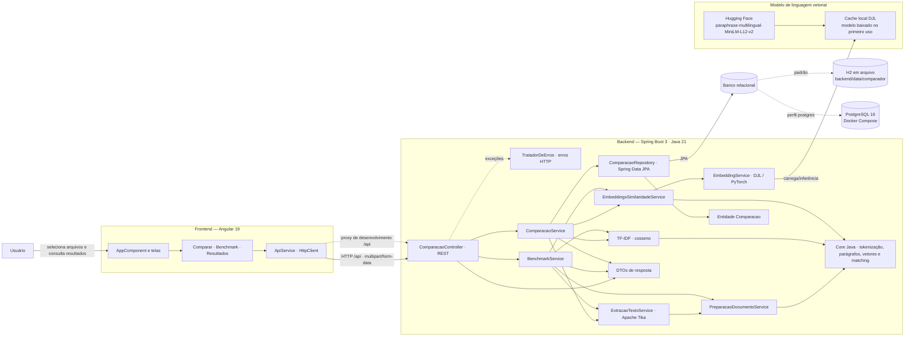
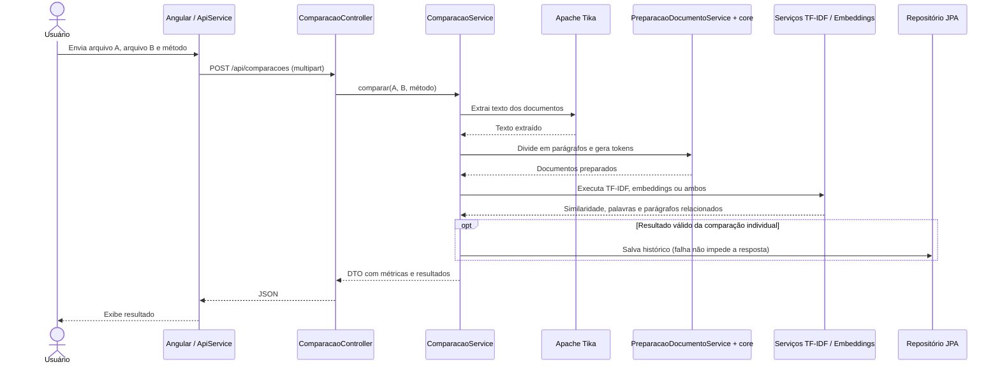

# Arquitetura do projeto

O sistema é uma aplicação web em duas partes: uma interface Angular envia documentos para uma API Spring Boot, que extrai e prepara os textos, executa os algoritmos de similaridade e persiste o histórico das comparações individuais.

## Visão geral

## Fluxo de comparação

## Responsabilidades principais

- **Frontend:** `AppComponent` seleciona as telas de comparação, benchmark e resultados. `ApiService` chama `/api/status`, `/api/comparacoes` e `/api/benchmark`; o proxy do Angular encaminha `/api` para `localhost:8080` durante o desenvolvimento.
- **API e orquestração:** `ComparacaoController` expõe os endpoints REST. `ComparacaoService` prepara dois documentos e executa o(s) método(s) escolhido(s). `BenchmarkService` recebe de 2 a 6 documentos, calcula todos os pares e resume médias; embeddings são gerados uma vez por documento nesse fluxo.
- **Extração e preparação:** Apache Tika extrai texto de formatos suportados. `PreparacaoDocumentoService` separa parágrafos e aplica o pré-processamento/tokenização do pacote `core`.
- **Algoritmos:** TF-IDF e cosseno usam vetores esparsos implementados no projeto. Embeddings usam DJL com PyTorch e o modelo multilíngue do Hugging Face; o download ocorre no primeiro uso. O pacote `core` também contém divisão de parágrafos, matching e operações com vetores densos.
- **Persistência:** comparações individuais bem-sucedidas são guardadas pela entidade JPA `Comparacao`; o histórico retorna as 30 mais recentes. O benchmark não grava histórico. O banco padrão real da configuração é H2 em arquivo; PostgreSQL 16 é alternativa pelo perfil `postgres` e pelo `docker-compose.yml`.

## Endpoints expostos

| Método | Rota | Função |
|---|---|---|
| `GET` | `/api/status` | Informa se embeddings estão habilitados e o modelo configurado. |
| `POST` | `/api/comparacoes` | Compara dois arquivos; método `TFIDF`, `EMBEDDINGS` ou `AMBOS`. |
| `GET` | `/api/comparacoes` | Lista o histórico recente. |
| `DELETE` | `/api/comparacoes` | Limpa o histórico. |
| `POST` | `/api/benchmark` | Compara todos os pares de 2 a 6 arquivos pelos métodos disponíveis. |

